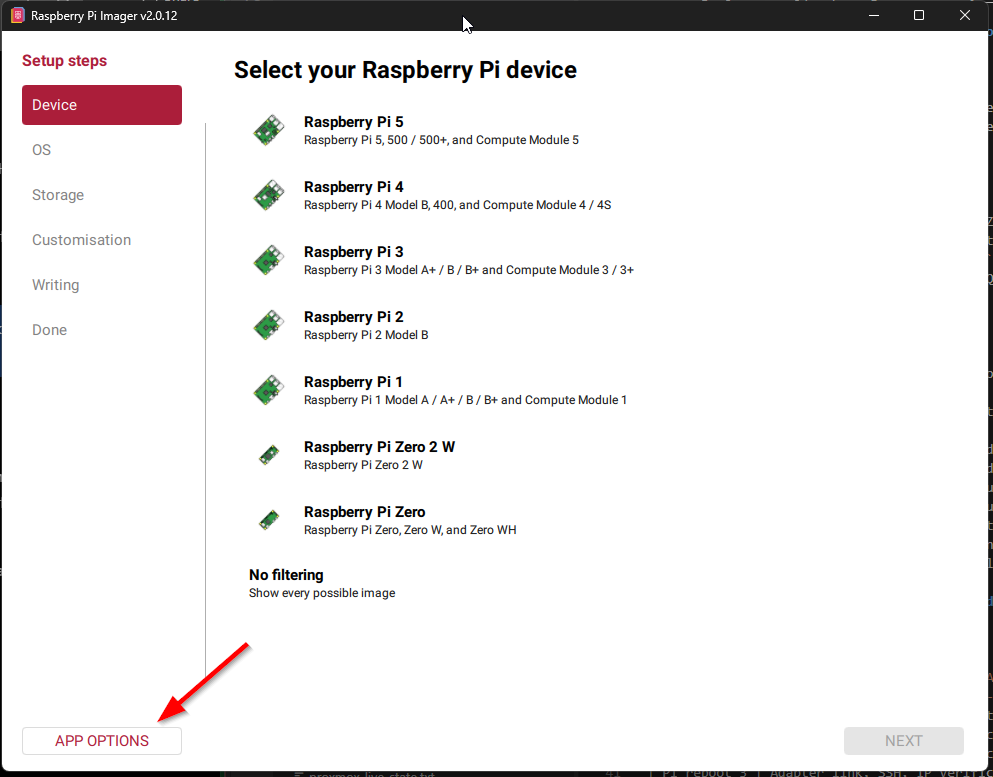
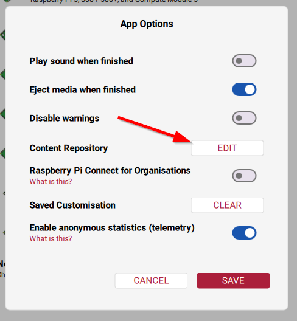
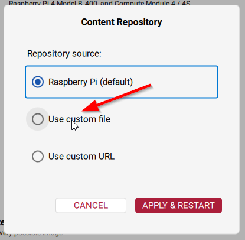
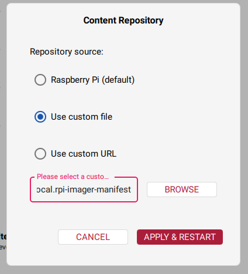
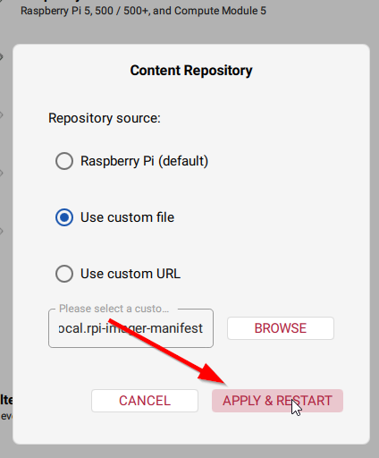

# v0.1.0 — Operating system image selection

Status: **flashed and USB/reboot functionality validated on 2026-11-01; archive filename/hash and custom manifest provenance remain unverified**. This document is part of [Issue #1](https://github.com/OnyxJeff/onyx-core/issues/1).

## Target

- Board: original Raspberry Pi Zero Rev 1.3 (ARMv6, not Zero 2 W).
- OS: **Raspberry Pi OS Lite (32-bit), Debian Trixie**.
- Vendor release date: **2026-10-06**.
- Vendor kernel line: **6.18**.
- Vendor compressed download size: **543 MB**.
- Vendor SHA-256 checksum for the downloaded image archive:

```text
2c302771f34c67a0b7ae7aa2e0dcdd3eac660504be59193c011ba79d412e1632
```

- Source: https://www.raspberrypi.com/software/operating-systems/

The 32-bit OS is compatible with the original Pi Zero; the 64-bit variant is **not**.

## Before writing the card

1. Preserve verified old ONYX CORE recovery archives outside the repository.
2. In **Raspberry Pi Imager v2.0.12**, go to **App Options → Content Repository → Edit → Use custom file**, browse to the locally generated custom manifest, and choose **Apply & Restart**. See the screenshot walkthrough below.
3. Select **Raspberry Pi Zero** and Raspberry Pi OS Lite **32-bit** from the resulting catalog. Confirm the image release details in the Imager UI. If downloading the image archive separately, validate its vendor SHA-256; Imager's normal image download/verification follows its own workflow.
4. Use Raspberry Pi Imager's OS customization to set hostname `svr-onyxcore`, a unique user/password, and SSH access. Keep any secrets out of GitHub.
5. For this Trixie release, the Raspberry Pi `rpi-usb-gadget` feature is intended to provide USB Ethernet (RNDIS on Windows) and a `10.12.194.1/28` fallback address when not using ICS. Follow the current Imager USB Gadget toggle if available for the selected image; **do not combine it with manual `modules-load=dwc2,g_ether` or a custom gadget-watcher** unless explicitly validated.
6. Do not enable or alter Windows Internet Connection Sharing in the initial USB enumeration test.
7. Record exact selected image filename and hash in the validation table before first boot.

## Image provenance record

| Field | Recorded value |
| --- | --- |
| Official release date | 2026-10-06 |
| OS | Raspberry Pi OS Lite (32-bit) |
| Debian | 13 (Trixie) |
| Kernel line | 6.18 |
| Vendor SHA-256 | `2c302771f34c67a0b7ae7aa2e0dcdd3eac660504be59193c011ba79d412e1632` |
| Actual download filename | Pending |
| Actual `Get-FileHash` result | Pending |
| Imager version used | 2.0.12 (screenshots and completed installation workflow) |
| USB gadget setup method | Custom local content repository manifest and enabled official USB Gadget Mode; operational `rpi-usb-gadget-ics.service` confirmed |
| First boot / reboot observations | Three Pi reboots and one Windows reboot retest passed on 2026-11-01; see [validation](../testing/usb-reboot-validation.md) |

## USB gadget guidance and risks

- Pi Zero USB **data** port is the micro-USB connector closest to mini-HDMI, not the power-only connector.
- Official USB gadget feature: https://www.raspberrypi.com/news/usb-gadget-mode-in-raspberry-pi-os-ssh-over-usb/
- Project readme: https://github.com/raspberrypi/rpi-usb-gadget
- The `rpi-usb-gadget` package can change between shared `10.12.194.1/28` and Windows ICS client mode; do not assume the same IP remains reachable after enabling ICS. Observe actual address and routes before making static overrides.
- A previous installation failed after reboot with the Windows RNDIS adapter disconnected. No services other than core network/SSH should be installed before three Pi reboot checks have passed.
- Document recovery and persistent-journal diagnostics before altering gadget services.

## Do not commit

Passwords, SSH private keys, token files, real `.env` files, backups, or secret-bearing NetworkManager profiles.

## Illustrated Imager custom-manifest setup (Windows)

These screenshots document the actual **Raspberry Pi Imager v2.0.12** UI sequence. Screenshots show how to select a local custom **content repository manifest**, not proof of the selected OS or of a successful image write.

1. From **Select your Raspberry Pi device**, click **APP OPTIONS** in the lower left.

   

2. In **App Options**, select **EDIT** next to **Content Repository**.

   

3. In **Content Repository**, select **Use custom file** rather than the Raspberry Pi default repository.

   

4. Click **BROWSE** and select the previously generated local `rpi-imager` manifest file. The file path shown in the screenshot is cropped; do **not** treat that truncated text as a known pathname.

   

5. Click **APPLY & RESTART**. The Imager catalog reloads from the selected manifest. Then choose the **Raspberry Pi Zero** (original), the **32-bit Lite** image, and enable **USB Gadget Mode** during customization, if the chosen image exposes the option.

   

### Reproducibility record still required

Record the manifest's true filename, generation method or source URL, Git commit/revision if available, and SHA-256. Never assume a UI manifest or restart alone enabled the USB gadget feature; after flashing, inspect generated boot customization and test USB link and multiple reboots.
